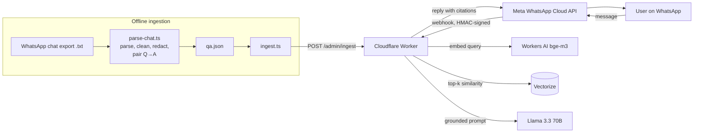

# Halacha RAG — WhatsApp AI Assistant

You text a halacha question to a WhatsApp number. The bot searches an archive of a rabbi's past answers from a WhatsApp Q&A group and writes a short answer based only on those answers. Each answer cites the original messages by date.

**Stack:** Cloudflare Workers · Vectorize (vector DB) · Workers AI (`bge-m3` embeddings + Llama 3.3 70B) · WhatsApp Cloud API · TypeScript. Everything here runs on free tiers.



**How it works**
1. **Ingestion:** `parse-chat.ts` parses the WhatsApp export (iOS and Android formats). It drops media and system messages and redacts phone numbers and emails. Then it groups each block of rabbi messages with the community questions posted just before it. Each chunk is embedded with multilingual `bge-m3`, which copes with Hebrew and Aramaic terms, and upserted into Vectorize. IDs are deterministic, so you can re-run ingestion without creating duplicates.
2. **Query:** An incoming message is checked against Meta's HMAC signature. The Worker replies `200` right away and does the slow work in `ctx.waitUntil`: it embeds the question, pulls the top-k matches above a similarity cutoff, and asks the LLM to answer **only** from those sources with `[n]` citations. The reply ends with a list of the sources the model actually cited.
3. **Guardrails:** If no retrieved answer passes the similarity cutoff, the bot doesn't call the LLM. It tells the user to ask the rabbi directly. Every reply also ends with a "consult your rabbi" disclaimer.

---

## Setup

### 0. Prereqs
- Node 18+ and a free [Cloudflare account](https://dash.cloudflare.com/sign-up)
- A [Meta developer account](https://developers.facebook.com/) (for WhatsApp)
- `npm install`

> [!IMPORTANT]
> The chat has other people's messages in it. Get permission from the rabbi and the group admin before you index it. Never commit `data/`; it is already in `.gitignore`.

### 1. Cloudflare: log in, create the vector index, deploy
```bash
npx wrangler login
npx wrangler vectorize create halacha-qa --dimensions=1024 --metric=cosine
```
Set `RABBI_NAME` in `wrangler.jsonc` (for example, `"Rabbi Cohen"`). Then set the admin token and deploy:
```bash
openssl rand -hex 24                     # generate a token, copy it
npx wrangler secret put ADMIN_TOKEN      # paste it
npm run deploy                           # prints https://halacha-rag.<you>.workers.dev
```

### 2. Export the chat and build the index
1. In WhatsApp, open the group → ⋮ / group info → **Export chat** → **Without media**. Save it as `data/chat.txt`. If you get a `.zip`, unzip it first.
2. Find the rabbi's exact display name:
   ```bash
   npm run senders -- data/chat.txt
   ```
3. Parse the chat into Q&A chunks. Then open `data/qa.json` and skim it to check the pairing looks right:
   ```bash
   npm run parse -- data/chat.txt --rabbi "Rabbi Cohen"
   ```
4. Embed and upload the chunks:
   ```bash
   export WORKER_URL=https://halacha-rag.<you>.workers.dev
   export ADMIN_TOKEN=<your token>
   npm run ingest
   ```
5. Test it without WhatsApp:
   ```bash
   npm run ask -- "Can I use the same sponge for meat and dairy?"
   ```

### 3. Connect WhatsApp (Meta Cloud API)
1. Go to [developers.facebook.com/apps](https://developers.facebook.com/apps) → **Create app** → type **Business**. Add the **WhatsApp** product.
2. Open **WhatsApp → API Setup**. Meta gives you a free **test phone number**. Under "To", add your own number as a recipient and verify it. In test mode, only numbers you add can message the bot (up to 5).
3. Copy the following values and save them as Worker secrets:
   ```bash
   npx wrangler secret put WHATSAPP_PHONE_NUMBER_ID   # "Phone number ID" on the API Setup page
   npx wrangler secret put WHATSAPP_TOKEN             # access token (see note below)
   npx wrangler secret put WHATSAPP_APP_SECRET        # App settings → Basic → App secret
   npx wrangler secret put WHATSAPP_VERIFY_TOKEN      # any random string you make up
   ```
4. Go to **WhatsApp → Configuration → Webhook → Edit**:
   - Callback URL: `https://halacha-rag.<you>.workers.dev/webhook`
   - Verify token: the same string you used for `WHATSAPP_VERIFY_TOKEN`
   - Click **Verify and save**. Then under webhook fields, **subscribe to `messages`**.
5. Text the test number from your phone. 🎉

> [!NOTE]
> The access token on the API Setup page **expires after 24 hours**. For a token that doesn't expire, go to Business Settings → Users → **System users**. Create an admin system user, assign it your app, and generate a token with the `whatsapp_business_messaging` and `whatsapp_business_management` permissions. Then run `wrangler secret put WHATSAPP_TOKEN` again.

Use `npm run tail` to watch live logs while you test.

---

## Configuration (`wrangler.jsonc` → `vars`)
| Var | Default | Notes |
|---|---|---|
| `RABBI_NAME` | `the Rabbi` | Used in the prompt and in replies |
| `CHAT_MODEL` | `@cf/meta/llama-3.3-70b-instruct-fp8-fast` | Any Workers AI text model |
| `EMBEDDING_MODEL` | `@cf/baai/bge-m3` | 1024 dims. If you change it, recreate the index with matching dims |
| `TOP_K` | `5` | Number of answers retrieved per question |
| `MIN_SCORE` | `0.45` | Cosine similarity cutoff. Lower it if the bot says "couldn't find" too often |
| `OPENROUTER_MODEL` | `meta-llama/llama-3.3-70b-instruct:free` | Only used if you set the `OPENROUTER_API_KEY` secret |

**Free tier usage:** Workers AI gives 10k "neurons" per day. That's roughly 80–100 answered questions a day with the 70B model, and ingesting a few thousand chunks costs about 1k neurons once. For more answers per day, switch `CHAT_MODEL` to a smaller model such as `@cf/meta/llama-3.1-8b-instruct-fp8`. Vectorize's free tier stores about 5M dimensions, which is roughly 4,800 chunks with `bge-m3`.

## Development
```bash
npm test           # parser unit tests
npm run typecheck
npm run dev        # wrangler dev --remote (AI and Vectorize bindings need remote mode)
```

## Possible next steps
- Rerank the top-k results with `@cf/baai/bge-reranker-base` before generation
- Have an LLM clean up Q&A pairing during ingestion, since exports have no reply-to context
- Keep short per-user conversation memory in KV or D1 for follow-up questions
- An eval set of question → expected-source pairs to measure retrieval hit rate
